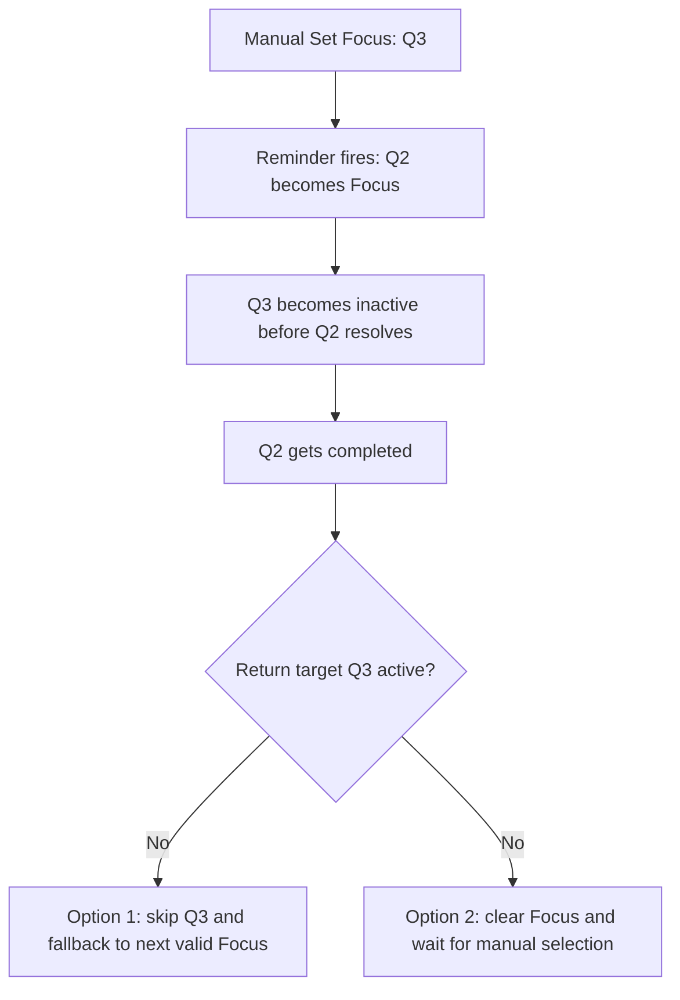

# Fini

**A quest-based productivity system for ADHD brains that helps people finish things.**

**Sign up for the Android beta:**

<a href="https://play.google.com/store/apps/details?id=com.fini.app">
  
</a>

## The Problem

Traditional todo apps fail people with ADHD. They accumulate unfinished tasks, create guilt, and get abandoned within weeks. The more tasks pile up, the harder it becomes to open the app at all.

ADHD brains don't struggle with laziness — they struggle with task paralysis, energy management, and the inability to finish what they started.


## The Idea

Fini replaces the todo list with a quest system inspired by RPG games like Skyrim, Cyberpunk, and The Witcher. Instead of staring at a wall of obligations, you see one active quest at a time.

Quests are organized into **Spaces** — named contexts like Personal, Work, or any project. A Space is a lightweight container; every quest belongs to exactly one space.

### Core Action Framework (Target — not all implemented yet)

Fini should help users move work out of their head and into one concrete next action inside a Quest, with Focus, Spaces, and reminders helping them start, continue, and finish without guilt.

- **Keep the work out of memory.** The app should hold the task so the user does not have to.
- **Make the next action visible.** An active Quest should show the next concrete step.
- **Keep the step small enough to start and finish.** If a Quest is too large, break it down until it is finishable.
- **Define done before starting.** The finish line should be clear before work begins.
- **Turn blockers into follow-up actions.** A blocker should become a separate action instead of freezing the current Quest.
- **Let the environment help.** Focus should reduce start friction, Spaces should provide context, and reminders should bring the right work back at the right time.

### Core Principles (Target — not all implemented yet)

- **One quest at a time.** No overwhelming lists. Just your current mission.
- **Spaces for context.** Group quests by area of life (personal, work, side project) without building a hierarchy.
- **Voice-first input.** Tap the mic, say what's on your mind. AI breaks it into small, achievable steps. _(post-MVP)_
- **Clear effort and urgency.** Set an Energy estimate—Small, Medium, or Large—separately from Priority—Low, Medium, or High—so a large task can still be low urgency.
- **Abandon is okay.** Quests can be abandoned without guilt. Closing a chapter is a decision, not a failure. Completed and abandoned quests live in History — out of sight, but recoverable.
- **Zero guilt accumulation.** The app never shows you a pile of unfinished tasks. Ever.
- **The app leads, not you.** It tells you what to do next. No planning, no prioritizing, no organizing.
- **Privacy & cyber security.** Your brain is your business. Fini is local-first with no cloud accounts. Encrypted LAN transport is part of sync work; local at-rest encryption is planned.
- **Local-first.** Everything runs on your device. No accounts, no cloud sync required. Optional sync later, on your terms.

### What Makes Fini Different

| Traditional Todo App           | Fini                    |
| ------------------------------ | ----------------------- |
| Shows all tasks at once        | Shows one quest         |
| User organizes and prioritizes | AI handles structure    |
| Unfinished tasks pile up       | Quests can be abandoned |
| Text input                     | Voice-first             |
| Assumes constant energy        | Adapts to energy level  |
| Guilt-driven                   | Guilt-free              |

## Architecture

| Folder | Role |
|---|---|
| `src/` | Vue 3 frontend — see `src/README.md` |
| `src-tauri/` | Rust backend (Tauri 2.0) — see `src-tauri/README.md` |
| `specs/` | Domain model and E2E specs shared between frontend and backend |

Each folder has its own `README.md` with structure and conventions. Each significant source file has a companion `.md` spec — see **Spec files** below.

## Spec files

Every significant source file has a companion `.md` file with the same name (e.g. `App.vue` → [[App.md]]). These files are the **source of truth** for that file: they describe its purpose, the sections or structure it must contain, its props/events/commands, and any design decisions. Code should be written to match the spec, not the other way around.

Convention:
- **Domain model specs** live in `specs/` — shared between frontend and backend
- **E2E QA specs** live in `specs/e2e/`
- **UI specs** live next to the source file they describe (e.g. `App.vue` → `App.md`)
- A spec file for a view describes its concept and sections
- A spec file for a component describes its props, events, and behaviour
- A spec file for a store lists its actions
- Folder-level `README.md` files describe the folder's role and overall structure
- Use `[[wikilinks]]` liberally to cross-reference related specs — every mention of another file or concept should link to its spec

## Local Network Sync

Fini is local-first with optional LAN sharing. MVP.1 networking is split into:

- [[DeviceConnection]] for pairing and channels (Network and Bluetooth, over iroh)
- [[SpaceSync]] for per-space replication over iroh sessions

How the parts work: [`docs/architecture/communication.md`](docs/architecture/communication.md).

See [[Network]] for transport-level contracts.

## CLI

Fini has separate CLI and desktop GUI entrypoints that share the same Rust backend and SQLite data model:

| Invocation | Mode |
|---|---|
| `fini` | CLI-only binary; returns current Focus quest by default |
| `fini --help` | Show CLI command groups and usage |
| `fini-app` | Desktop GUI binary used by app launchers and bundles |

Build planes are explicit:

- Desktop GUI builds use `ui-plane`.
- Mobile builds use `ui-plane` only; CLI code is not compiled into mobile bundles.
- The container runtime image (stage `runtime` of `containers/linux/Containerfile`) uses `cli-plane` only and exposes `/usr/local/bin/fini`.
- Release artifacts keep GUI and CLI distribution separate. Linux and Windows releases publish standalone CLI archives alongside GUI installers.

The CLI binary is built separately from the desktop app binary:

```bash
cargo build --manifest-path src-tauri/Cargo.toml --bin fini --features cli-plane
npm run tauri build -- --features ui-plane
```

CLI release artifacts include their Rust target so the updater cannot select an
archive for the wrong ABI:

| Platform | CLI artifact |
|---|---|
| Linux x64 | `fini-vX.Y.Z-linux-x86_64-unknown-linux-musl-cli.tar.gz` |
| Windows x64 | `fini-vX.Y.Z-windows-x86_64-pc-windows-msvc-cli.zip` |
| Windows arm64 | `fini-vX.Y.Z-windows-aarch64-pc-windows-msvc-cli.zip` |

The Linux CLI is a static musl binary with no Bluetooth, for x86_64 only. The
release has no arm64 Linux CLI; the arm64 Linux desktop app is still released.

`fini update` explicitly downloads, zipsign-verifies, validates, and installs the
matching standalone archive. `fini update --dry-run` checks the matching release
without replacing the binary. Normal CLI invocations check at most once per 24
hours; `FINI_DISABLE_AUTO_UPDATE=1` disables only that automatic path. The CLI
uses its embedded zipsign public key, which is separate from the Tauri desktop
updater key and `latest.json` desktop manifest.

## Tech Stack

| Layer     | Technology                  |
| --------- | --------------------------- |
| Framework | Tauri 2.0                   |
| Frontend  | Vue 3 + TypeScript + Vite   |
| Styling   | Tailwind CSS + DaisyUI      |
| Icons     | Heroicons                   |
| State     | Pinia                       |
| Database  | SQLite via Diesel ORM       |
| Backend   | Rust                        |

## Target Platforms

- Linux (native + Flatpak)
- Windows
- Android
- macOS (planned)
- iOS (planned)

## Development

### Prerequisites

- Rust (via rustup)
- Node.js + npm
- Linux: webkit2gtk4.1-devel and related packages
- Android: a container engine (the android build image has the JDK, the SDK and the NDK), and adb on the host to deploy (see `src-tauri/gen/android/README.md`)
- Container gates and e2e: a container engine, podman or docker (see `docs/container.md`, "Container engine")

### Run (desktop)

```bash
npm ci
make dev
```

### Build (desktop)

```bash
make build
```

On newer Linux toolchains (e.g. Fedora 44+), local AppImage bundling defaults to
`NO_STRIP=true` because `linuxdeploy` vendors an older `strip` that cannot parse
`.relr.dyn` sections emitted by those toolchains; see `src-tauri/README.md` for
details. This only affects local builds — CI release builds are unaffected.

### Release

Releases run only in CI (GitOps): a signed annotated `v*` tag on the version commit starts the release workflow `release-tag.yml`. CI owns tests, builds, signing checks, packaging, artifacts and publication. The Makefile is for local development only; no `make` target is a release step.

The only release path is the `Release Button` GitHub Actions workflow, which the project owner starts by hand. It compares the latest `v*` tag with `origin/main`, chooses the next version from Conventional Commit subjects, creates one `chore: release vX.Y.Z` metadata commit, pushes `main` and a `release/vX.Y.Z` trace branch, and creates a signed annotated tag. The tag push starts the release pipeline. If there are no commits since the latest release tag, it exits successfully as a skipped no-op and does not create a commit, tag, or release pipeline run.

Because `main` is protected, the button needs an automation token that can update protected branches for the repository:

```bash
gh auth token | gh secret set RELEASE_AUTOMATION_TOKEN --repo VRuzhentsov/fini
```

Before using the button, also add the release signing key secrets once:

```bash
release_key_id="$(git config user.signingkey)"
gpg --armor --export-secret-keys "$release_key_id" | gh secret set RELEASE_TAG_GPG_PRIVATE_KEY
gpg --armor --export "$release_key_id" | gh secret set RELEASE_TAG_GPG_PUBLIC_KEY
```

If the release key has a passphrase, also add it:

```bash
read -rsp 'GPG passphrase: ' RELEASE_TAG_GPG_PASSPHRASE; printf '\n'
gh secret set RELEASE_TAG_GPG_PASSPHRASE --body "$RELEASE_TAG_GPG_PASSPHRASE"
unset RELEASE_TAG_GPG_PASSPHRASE
```

### Build (Android)

The Android builds run in the `build` stage of `containers/android/Containerfile`
(JDK 21, the Android SDK and NDK, Rust and Node), through `containers/run.sh`
with the container engine. The host needs only the container engine, and adb for
the deploy targets.

```bash
make android-build

# git-derived local debug-signed release deploy (shares com.fini.app's identity)
make android-release-deploy-debugsigned

# git-derived local true-debug deploy (separate com.fini.app.debug identity)
make android-debug-deploy
```

`make android-release-deploy-debugsigned` builds a local Android release APK with git-derived version metadata:

- `versionName`: latest reachable git tag plus short SHA, for example `0.1.18+dev.65be60e`
- `versionCode`: current epoch seconds, so repeated local installs always upgrade cleanly

It signs with the local Android debug keystore and installs with `adb install -r`:

```bash
make android-sign-debug
make android-install-debug
make android-launch
```

Signed debug APK path: `bin/fini.apk`

Because it shares `com.fini.app`'s package id, this install still needs to be certificate-compatible with whatever is already on the device -- it will conflict with a Play-Store-installed `com.fini.app` the same way any differently-signed build of the same package id does. Two options avoid that conflict, for different needs:

- `make android-debug-deploy` builds the actual `debug` buildType, which installs as its own separate `com.fini.app.debug` package (see `src-tauri/gen/android/app/build.gradle.kts`'s `applicationIdSuffix`) -- coexists with a Play Store install indefinitely, no uninstall ever required, and also enables Tauri's Kotlin logging (suppressed in the release profile).
- If you specifically need a purely local install that can *replace* a Play-installed `com.fini.app` build (matching its identity, not living alongside it) without uninstalling, use the local release-signing path instead:

```bash
make android-release-deploy-local
```

That flow stays local and requires release-signing inputs in the environment:

- `ANDROID_KEYSTORE_PATH` or `ANDROID_KEYSTORE_BASE64`
- `ANDROID_KEYSTORE_PASSWORD`
- `ANDROID_KEY_ALIAS`
- `ANDROID_KEY_PASSWORD`

Output APK path for the local release-signing flow: `bin/fini-release.apk`

### Build (Flatpak)

```bash
flatpak run org.flatpak.Builder --force-clean --user --install flatpak-build com.fini.app.yml
flatpak run com.fini.app
```

### Build (container runtime)

Use the CLI runtime image when you want to run the CLI inside a container. It
is the `runtime` stage of `containers/linux/Containerfile`: `debian:bookworm-slim`
with the static musl CLI only. The Make targets use the container engine
(`docs/container.md`, "Container engine").

```bash
make runtime-image
make runtime-smoke

# default CLI behavior
${CONTAINER_ENGINE:-podman} run --rm fini-runtime

# explicit CLI commands (the data is in /data)
${CONTAINER_ENGINE:-podman} run --rm fini-runtime --help
${CONTAINER_ENGINE:-podman} run --rm -v fini-data:/data fini-runtime --json space list
```

The published container image has only the release CLI binary. The images for
the builds and the e2e tests are the other stages of `containers/linux/` and
`containers/android/` (`docs/container.md`); they are not published.

## Status

🚧 Early development. Building the MVP.

## Delivery Plan

- **MVP**: Local-first core loop on Linux/Windows/Android with functional parity (`Focus` / `History` / `Settings`, reminders, repeating series+occurrences)
- **MVP.1**: LAN pairing + sync (mutual confirmation, websocket data-plane, near-real-time replication, offline queue/replay, shared series occurrence behavior)
- Planning baseline and spec deltas are tracked in `docs/plans/2026-03-21-mvp-baseline.md`

## Contributing

This is an open-source project. Contributions, ideas, and feedback are welcome.

If you have ADHD and want to help shape this product — you're exactly who we're building this for.

## License

Fini is free software under the [GNU Affero General Public License v3.0 or
later](LICENSE) (AGPL-3.0-or-later): you may use, study, change and share
it, and anyone who distributes a modified version, or lets people use one
over a network, must offer its source under the same license.

The name "Fini" and its icon are not covered by the license; see
[TRADEMARKS.md](TRADEMARKS.md). A fork is welcome under its own name.

The reasoning, modelled on Signal's, is in
[ADR-0009](docs/adr/0009-agpl-and-iroh-communication-stack.md) (D1).
