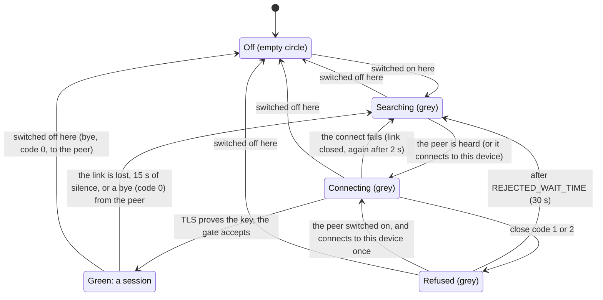

# Communication

How two devices pair, connect, and sync their spaces. The code is in the
services, repositories and commands of `src-tauri/src/` (see "The parts").
The words are in [`docs/glossary.md`](../glossary.md).

## The standard

Two devices find each other within 10 seconds under good conditions. This
applies to Bluetooth and Network, to a new pair and to a new channel.

- **Start:** for a new pair, the second device opens Add Device. For a new
  channel, the second device switches it on.
- **Stop:** for a new pair, each device shows the other in its Add Device
  list. For a new channel, the row is green on each device.
- **Good conditions:** the devices are near each other, Bluetooth is on,
  Wi-Fi is as it is.

A device that is slower under good conditions has a defect in Fini. The steps
after the stop (the pair request, the code, the time to green) must be fast,
but have no fixed limit.

## The parts

The architecture of the app is in [ADR-0010](../adr/0010-app-architecture.md).
Each part uses only the parts above it in this tree. The app start builds
them in this order (`lib.rs`) and registers each one with `app.manage`.
Paths are from `src-tauri/src/`.

```
app start (composition root)    lib.rs
├── Identity                    models/device.rs: id, name, iroh key
├── EventBusService             services/event-bus.service.rs
├── channels                    services/channel.service.rs: the
│   │                             ChannelService interface, DataLink
│   ├── NetworkChannelService   services/network-channel.service.rs:
│   │                             iroh over IP, iroh mDNS lookup
│   └── BluetoothChannelService services/bluetooth-channel.service.rs:
│                                 iroh over ble-gatt-iroh, scanner,
│                                 advertiser
├── SpaceSyncService            services/space-sync.service.rs: sessions,
│                                 sync, takes fini/sync/4 links
├── DeviceService               services/device.service.rs: pairing, Add
│                                 Device, the channel switches, takes
│                                 fini/peer/1 links
└── link handlers               set on each channel last
```

The repositories (`repositories/`) read and write the stored data:
`DeviceRepository`, `ChannelRepository`, `SpaceMappingRepository`,
`OutboxRepository`. `SpaceSyncService` and `DeviceService` hear each other
only through the event bus. The UI gets every event as the Tauri event
`fini-event`; its stores are `device.store.ts` and `space-sync.store.ts`.

The screens: `SettingsView.vue` (devices, pair requests),
`DeviceSetupDialog.vue` (Add Device), `DeviceView.vue` (one
paired device: channel switches, spaces, sync queue, Unlink), and
`IncomingSpaceResolutionDialog.vue` (a request to sync a space).

## Pairing

Pairing makes the trust between two devices, one time for each pair.

1. The person opens Add Device on the two devices and selects a channel. A
   device shows in the list of the other device only while it is in Add
   Device mode.
2. The person presses Pair on one device. The other device shows the request.
3. The person accepts there. Then the first device shows a code of 6 digits.
4. The person types the code on the second device. The two devices save the
   pair and pin the key of the other device.

What a device hears before the pair (an mDNS record, an advertisement) only
helps to find the device. The trust is the pair, the pinned key, and the
selected channel. Fini does not use the Bluetooth pairing of the operating
system (ADR-0006).

- After a pair over Bluetooth, the first session uses the link of the
  pairing.
- A pair has the two channels, each with a switch on each device
  ([ADR-0011](../adr/0011-a-channel-is-a-switch-on-each-device.md)). A new
  pair has the channel of its pairing `On` and the other one `Off`. There is
  no Add and no unlink for a channel: the person switches it on or off on
  each device.
- "Unlink <device>" on the Device page removes the pair on that device, ends
  its sessions, and closes its Bluetooth links.
- The identity of a device is `device.id` (a UUID that does not change) and
  `device.name`. A paired device keeps the name it had at the time of
  pairing (`display_name`). The screens show no UUIDs.

## Channels

A channel is a pipe. It holds one live connection to each paired device that
has the channel on. It does not know what goes through the connection.

- **Green** is a live iroh connection that TLS proved, with a session on it
  (`SpaceSyncService::has_session_on`). A device that was only heard is not
  green.
- Each channel connects by itself to each paired device that has the channel
  on and has no session (`ChannelService::keep_serving`). On Bluetooth, only
  the device with the smaller id connects; the other one advertises and
  accepts (`BluetoothChannelService::start_exchange`). The first session
  after a pairing goes over the pairing link.
- `ChannelService::is_on` tells if the channel is on for a device. A
  Bluetooth connect stops when the channel goes off during it.
- A connection that hears nothing for 15 s ends: the channel turns grey.
- A session needs the channel on on the two devices. A device that has the
  channel off for every pair is not reachable on it: Bluetooth does not
  advertise (`refresh_advertising`), and Network does not run its mDNS
  lookup (`NetworkChannelService::set_any_pair_on`), unless Add Device is
  open. A device that has the channel on for another pair stays reachable,
  and its gate refuses the session (code 2).
- A channel switched off ends its session with a bye (code 0). The other
  device turns grey at once. It does not wait: it finds the device again in
  the usual way when that device advertises again, as after a link that
  was lost out of range.
- Bluetooth stops its GATT server only when the last live link is closed,
  so that the bye goes out before the link stops.

### States of a channel

One channel of one pair, as one device sees it. The colour is the colour of
the row on the Device page. On Network the two devices connect; on
Bluetooth only the device with the smaller id connects, and the other one
accepts.



A crossing (code 3) or a session that runs already (code 4) changes
nothing: the other connection carries the session.

## Who is on the other end

iroh's TLS handshake proves the key of each side. The service that takes
the connection finds the paired device by that key
(`DeviceRepository::find_by_key`). There is no auth frame.

| ALPN | Carries | Taken by |
|---|---|---|
| `fini/sync/4` (`SYNC_ALPN`) | a sync session; the last part is the protocol version | `SpaceSyncService` |
| `fini/peer/1` (`PEER_ALPN`) | the frames before a session: pairing, `IdentifyDevice` | `DeviceService` |

Before pairing there is no pinned key. Over Bluetooth, the identify step
uses a plain link (`BleDataLink`) and gets the key. The pair request then
uses an iroh connection on that same BLE link (`keep_identify_link`): the
accepting side gives the link to iroh when the first QUIC packet comes
(`BleDataLink::recv`). A device whose key is known already skips the
identify step.

### Close codes

`SpaceSyncService` ends or rejects a session with a QUIC close code. The
other side reads it (`DataLink::close_code`).

| Code | Meaning | The other side |
|---|---|---|
| 0 | bye: the channel was switched off here (`CLOSE_BYE`) | its row is grey; it finds this device again in the usual way |
| 1 | no pair has this key | waits, then tries again |
| 2 | the channel is off here (a missing row is off) | waits, then tries again; its row is grey |
| 3 | crossing: the other connection is kept | does nothing |
| 4 | a session runs already | does nothing |

After code 1 or 2, the next Bluetooth connect waits `REJECTED_WAIT_TIME`
(Network: `FAILURE_COOLDOWN`).

On Bluetooth, the device with the bigger id does not connect. When it
refused a device with code 2 less than `REJECTED_WAIT_TIME` ago and the
channel is then switched on here, it connects to that device once
(`BluetoothChannelService::connect_once_after_switch_on`). Without this, the
other device stayed grey until its wait ended (32 s measured).

### Bluetooth links after a session

- The side that closed the session keeps the BLE link until its close went
  out. ble-gatt-iroh then closes the link (transport hooks).
- The side that receives the close closes the BLE link at once
  (`run_exchange`). QUIC sends nothing more after a close, and a link kept
  up for the drain (33 s measured) made the next connect fail.
- A connect that fails closes its link, and tries again after 2 s.

### Crossing

On Network, the two devices can connect to each other at the same time. (On
Bluetooth only one of them connects.) Each device keeps
the connection that the device with the smaller id started. A device's own
connection counts for 3 s after its session starts
(`CROSSING_WINDOW`). A connection from the peer after that time means the
peer started again: the new session replaces the old one.

## SpaceSync

`SpaceSyncService` sends the changes of mapped spaces.

- A local change, a frame received, a new session, or an event of a
  channel (`DeviceHeard`, `ConnectChanged`) wakes it.
- The keeper runs a tick when woken. On Android, the Bluetooth parts wait
  for the Activity.
- A frame goes over the first green channel, the primary first.
- Work for a device with no green channel stays in the outbox. SpaceSync
  does not connect and does not try again: a new session wakes it.
- A pair or a channel that changes (`PairedDevicesChanged`,
  `ChannelsChanged`) ends the sessions whose channel is not on any more, and
  wakes the keeper: a channel that is on now gets its session.

A session owns its link. The session slot keeps a sender (`SessionCommand`)
to the session's task, not the link, so that two writers cannot mix the
fragments of two frames.

## Spaces that a pair syncs

A pair syncs only the spaces that the two devices map.

- A mapping is for one pair and one space. The two devices keep the same
  mapping state.
- One device asks to sync a space. The other device shows the request, and
  the person approves one space at a time.
- A built-in space has the same id on the two devices. A custom space can
  need a choice: a new space, or a space that exists
  (`space_sync_resolve_custom_space_mapping`).
- A new mapping first sends all quest changes of the space (the bootstrap).
  Then each change syncs in the background.
- To stop, one device ends the mapping. The two devices write
  `end_of_sync_at`.
- The approval is for the pair and the space, not for a channel. A change of
  channel, a reconnect, or a tick does not ask again.

## Not done yet

- A held Bluetooth link uses high connection priority. It should use low
  power while idle. This needs a ble-gatt change.
- Android should reconnect from the background scan that the Bluetooth chip
  filters. This needs a ble-gatt change.
- SpaceSync reads the outbox one event at a time. Issue #196 is about a
  change mark for each device and space.
