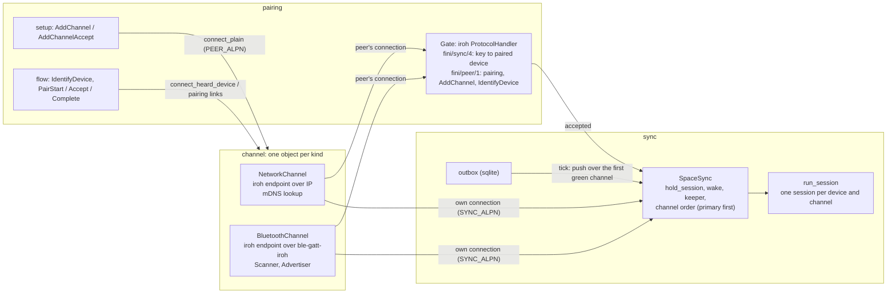
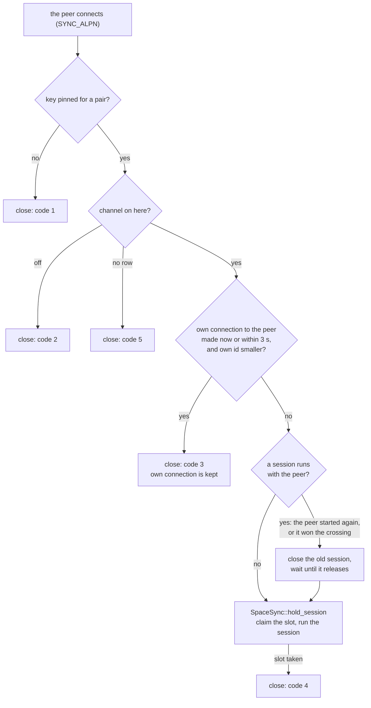

# Communication

How two devices pair, find each other, connect, and sync their spaces. The
code is in `src-tauri/src/services/communication/`. The words are defined in
[`docs/glossary.md`](../glossary.md). This document is written in STE (see
[`docs/naming.md`](../naming.md)).

## The standard

Two devices find each other within 10 seconds under good conditions:

- **Start:** the search runs on the two devices. That is, the second device
  opens its dialog.
- **Stop:** each device shows the other in its list of devices that it can
  connect to. For a new pair, this is the Add Device list. For a new channel,
  this is the setup dialog of the channel, where OK becomes available.

This applies to Bluetooth and to Network, to a new pair (Add Device) and to a
new channel for a pair. Good conditions: the devices are near each other,
Bluetooth is on, Wi-Fi is as it is. A device that is slower under these
conditions has a defect in Fini.

The steps after the stop are not in the standard: the pair request, the
code, and the time until the channel is green. These steps must also be
fast, but they have no fixed limit.

## Pairing

Pairing makes the trust between two devices. It happens one time for each
pair, not for each channel.

1. The person opens Add Device on the two devices and selects a channel
   (Network or Bluetooth). Only a device in Add Device mode shows in the list
   of the other device.
2. On one device, the person presses Pair on the other device. The other
   device shows the pair request.
3. The person accepts the request there. Only now does the first device show
   a code of 6 digits.
4. The person types the code on the second device. The two devices save the
   pair and pin the key of the other device.

What a device hears before the pair (an mDNS record, a Bluetooth
advertisement) is not trusted. It only helps to find the device. The pair, the
key, and the selected channel are the trust. The Bluetooth pairing of the
operating system is not used (ADR-0006).

After a pair over Bluetooth, the first session uses the Bluetooth link of the
pairing: the channel turns green without a new search.

To add a second channel to a pair, the person presses Add on the channel row
on the two devices (a setup). A setup needs no code, because the pair has the
trust already.

Unlink on the device page removes the pair on that device. It ends the
sessions with the other device and closes its Bluetooth links.

The identity of the device is two settings rows: `device.id` (a UUID that does
not change) and `device.name` (the name that other devices see). The name of
a paired device (`display_name`) is the name at the time of pairing. It does
not change when the other device changes its name later. The screens do not
show the UUIDs.

## The modules

| Module | Owns |
|---|---|
| `pairing` | trust between two devices: Add Device, the pair, the channels of a pair, the gate |
| `channel` | the connections: one object per channel kind, each a pipe for bytes |
| `sync` | SpaceSync: what goes through the pipes, and when |

## Channels are pipes

A channel holds one live connection to each paired device that has the channel
on. A channel does not know what goes through the connection.

- **Green** is a live connection: an iroh connection that the TLS handshake
  proved, with a session on it (`ChannelService::is_green`). A device that
  was only heard (an mDNS record, a Bluetooth advertisement) is not green.
- **Network** (`channel/network.rs`, `NetworkChannel`): an iroh endpoint over
  IP. iroh's mDNS lookup finds the devices. QUIC's keep-alive holds the
  connection.
- **Bluetooth** (`channel/bluetooth/`, `BluetoothChannel`): an iroh endpoint
  over `ble-gatt-iroh`. A scan finds the devices (`Scanner`). The connection
  is held like the Network one.
- Each channel connects by itself (`ChannelService::keep_serving`, on each
  tick) to every paired device that has the channel on and has no session.
- A connection that hears nothing for 15 s ends (`iroh_link::transport_config`):
  a device whose radio went away turns grey after about 15 s.



## Who is on the other end

There is no auth frame. iroh's TLS handshake proves the key of each side.
Pairing pins the other device's key (the PIN step). The gate finds the paired
device by the key that the handshake proved (`pairing::paired_device_for_key`).

Two ALPNs (the protocol name that the TLS handshake agrees on):

| ALPN | Carries |
|---|---|
| `fini/sync/4` (`SYNC_ALPN`) | a sync session. The last part is the protocol version: two builds on different versions do not connect. |
| `fini/peer/1` (`PEER_ALPN`) | the frames before a session: `PairStart`, `PairAccept`, `PairComplete`, `AddChannel`, `IdentifyDevice` |

Before pairing there is no key to pin. Over Bluetooth, the identify step and
the pair request first use a plain link (`BleDataLink`) or an iroh connection
to the key the device advertised. Pairing pins that key.

### Refusals

The gate refuses a session with a QUIC close code. The connecting side reads
it (`DataLink::close_code`).

| Code | Meaning | What the connecting side does |
|---|---|---|
| 1 | this key is pinned for no pair | waits, then tries again |
| 2 | the channel is off here | waits, then tries again |
| 3 | crossing: the other device's connection is kept | nothing: that connection carries the work |
| 4 | a session runs already | nothing |
| 5 (`CLOSE_CHANNEL_MISSING`) | the channel of the pair is missing here: it was removed, or its setup is open | removes its own row of the channel, unless a setup with the device is open there |

Code 5 gives the same answer for "removed" and for "not set up", so it tells
nothing about the past. After a rejection with code 1, 2 or 5, the next
connection over Bluetooth waits `REJECTED_WAIT_TIME` (Network:
`FAILURE_COOLDOWN`). After the rejection gets to the peer, the gate closes the
Bluetooth link of the rejected session.

### Two connections at the same time

Both devices can connect to each other at the same moment. Each device then
keeps the connection that the device with the smaller id started, and closes
the other. Both devices apply the same rule, so they keep the same
connection. A device's own connection counts as "connecting" while it is made
and for 3 s after its session starts (`session::CROSSING_WINDOW`). A connection
from the peer after that time means that the peer started again: the old
session closes, and the new one replaces it.



## SpaceSync

`SpaceSync` (`sync/space_sync.rs`) is one object that the
`DeviceConnectionState` owns. It owns:

- the wake signal: a change, a frame received, or a session that comes up
  wakes it (`wake`, `wake_after`);
- the keeper: the task that runs a tick when woken. It starts with the app.
  On Android, the Bluetooth channel and the foreground service wait until the
  webview starts to load its page (`activity_ready`), because they need the
  Activity;
- the sessions: every live link goes to `hold_session`, which runs
  `run_session` on it;
- which channel a frame goes over: the first green channel in the pair's
  order, the primary first (`channel_order_for`).

Work for a device that has no green channel waits in the outbox. Nothing in
SpaceSync connects or retries: the channels connect by themselves, and a
session that comes up wakes the next tick.

## Spaces that a pair syncs

A pair syncs only the spaces that the two devices map, one space at a time.

- A mapping is for one pair and one space (`space_id`). The two devices keep
  the same mapping state.
- One device asks to sync a space. Only the other device shows the request.
  The person approves one space at a time.
- A built-in space has the same id on the two devices. A custom space can
  need a choice: make a new space, or map it to a space that exists
  (`space_sync_resolve_custom_space_mapping`).
- When a mapping starts, the two devices send all quest changes of that
  space and merge them (the bootstrap).
- After that, each change to a quest in a mapped space syncs in the
  background, with no dialog.
- To stop, one device ends the mapping. The two devices write
  `end_of_sync_at`, and the space stops to sync.
- Each mapping records `last_synced_at`.
- The approval is for the pair and the space, not for a channel. A change of
  channel does not ask again. A space that syncs already does not ask again
  at start, at reconnect, or on a tick.

## The objects and their files

| Object | File | Owns | Who calls it |
|---|---|---|---|
| `DeviceConnectionState` | `pairing/mod.rs` | the identity, the channels, the session slots, SpaceSync | the Tauri commands |
| `NetworkChannel` | `channel/network.rs` | the IP endpoint, the mDNS lookup, own connections in flight | the tick (`keep_serving`), setup (`connect_plain`) |
| `BluetoothChannel` | `channel/bluetooth/mod.rs`, `endpoint.rs` | the Bluetooth endpoint, the delivery schedule | the tick, setup, pairing |
| `Scanner` | `channel/bluetooth/scanner.rs` | the one Bluetooth scan, the devices heard, turns on the radio | `BluetoothChannel`, pairing |
| `Advertiser` | `channel/bluetooth/advertiser.rs` | what this device advertises, and if it does | `BluetoothChannel` |
| `BluetoothAdapter` | `channel/bluetooth/adapter.rs` | the adapter of this process (one per process) | the Bluetooth objects |
| `Gate` | `pairing/gate.rs` | the rules for who may connect | iroh's `Router` |
| `SpaceSync` | `sync/space_sync.rs` | when sync runs, the sessions, the channel order | the channels, the gate, the commands |
| `BluetoothCarrier` | `pairing/carrier.rs` | the links that Bluetooth pair requests came on | pairing |

The screens: `SettingsView.vue` (the list of devices and the pair requests),
`DeviceSetupDialog.vue` (Add Device, and the setup of a channel), and
`DeviceView.vue` (one paired device: its channels, its spaces, its sync
queue, Unlink). `IncomingSpaceResolutionDialog.vue` shows a request to sync a
space. The end-to-end checks on real devices are in `specs/e2e/transports.md`
and in the specs that use `specs/e2e/components/`.

## A DataLink and a session

A `DataLink` (`channel/mod.rs`) is one open connection to one device. It moves
bytes and nothing more. It has no device id, no quests and no outbox. Two
types implement it:

```rust
struct IrohDataLink {     // one QUIC stream on an iroh connection
    send, recv,
    peer_addr: Option<String>,
    peer_key: String,     // the key TLS proved
}

struct BleDataLink {      // a GATT characteristic, before pairing only
    channel: DatagramChannel,
    peer_addr: String,
}
```

A session (`sync/session.rs`, `run_session`) owns its link. The session slot
registry in `DeviceConnectionState` keeps a sender to the session's task, not
the link:

```rust
pub enum SessionCommand { Forward(PeerFrame), Close }
```

Thus there is no lock on each write, and two writers cannot mix the fragments
of two frames on Bluetooth. A session ends when its link ends.

## Frame, envelope, framing

- `PeerFrame`: one message. A value.
- `FrameEnvelope` (`{ v, enc, payload }`): the versioned wrapper around an
  encoded frame, so that encryption can be added later.
- Framing: where one blob ends on the byte pipe. On a QUIC stream this is a
  length prefix; the connecting side first writes an empty frame, so that the
  other side sees the stream (`STREAM_START`). On Bluetooth before pairing, it
  is the GATT fragments.

## Not done yet

- Bluetooth keeps high connection priority on each link. A held link should
  use low power while idle (step 0 measured about +7 mAh a day for a held
  low-power link). This needs a ble-gatt change.
- Android should reconnect from its background scan that the Bluetooth chip
  filters, not from Fini's own scan. This needs a ble-gatt change.
- A Bluetooth channel setup on a pair that removed the channel just before
  takes 12 to 18 s on hardware, over the standard.
- When a pair with a live session is removed and Add Device opens at once,
  the old connection can keep the radio for up to 15 s.
- SpaceSync finds what to send from the outbox, one event at a time. Issue
  #196 is about a change mark per device and space.
